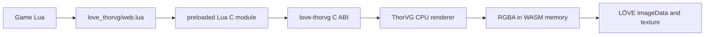

# Experimental web backend

!!! warning "Experimental and not in the desktop release archives"

    Web support uses a custom, pinned love.js build. The repository builds and
    tests that runtime end to end, but the backend is still experimental rather
    than a general-purpose LÖVE browser distribution. Test your exported game.

Stock browser ports of LÖVE use PUC Lua 5.1 rather than LuaJIT. That means the
desktop adapter's FFI calls cannot work in a browser. `love-thorvg` solves this
with a small built-in Lua C module instead of trying to emulate FFI in JavaScript.



The architecture has one WebAssembly module and one memory arena. ThorVG is
statically linked into the same custom love.js runtime as LÖVE. The binding
returns RGBA bytes to Lua, and `love.image.newImageData` creates the uploadable
image. No JavaScript bridge is involved during normal Lua rendering.

## What is implemented

- SVG and Lottie decoding and CPU rasterization under Emscripten;
- the same `require('love_thorvg')`, `new`, playback, resize, cache, stats, image,
  and draw API used on desktop;
- assets read through `love.filesystem`, including resolver callbacks for
  relative images and mapped fonts;
- explicit release plus a userdata finalizer as a safety net;
- automated Node proof, an automated Chromium run of the real LÖVE game, and a
  live browser example on the documentation site.

Threads and SIMD are disabled in the first backend. Raster pixels cross one
additional WASM-to-Lua string copy before becoming `ImageData`; size documents
conservatively and use frame caching for repeatedly visited frames.

[Run the live LÖVE example](/love-thorvg/experimental/web-demo/){ .md-button .md-button--primary }

The example executes `examples/web/game/main.lua` in the custom browser
runtime. It loads Lottie artwork shared with the native examples, advances it
in `love.update`, draws it in `love.draw`, and accepts keyboard input to switch
assets.

## Set up web support

Web support is not a drop-in addition to a stock love.js build. The
`love_thorvg_web` Lua C module and ThorVG must be compiled into the LÖVE
WebAssembly runtime. Use the repository's pinned build first; only maintain a
custom love.js integration if you need to change that runtime.

### 1. Install the build tools

You need Git, CMake, Python, Meson, Ninja, and Emscripten 6.0.12. One way to
install and activate the pinned Emscripten SDK is:

```sh
git clone https://github.com/emscripten-core/emsdk.git
cd emsdk
./emsdk install 6.0.12
./emsdk activate 6.0.12
source ./emsdk_env.sh
python3 -m pip install meson ninja
```

Run `source emsdk_env.sh` in each new shell before building. Confirm that
`emcmake`, `em++`, `cmake`, `meson`, and `ninja` are on `PATH`.

### 2. Build the custom runtime

From a love-thorvg checkout, run:

```sh
./scripts/build_web_example.sh build-lovejs dist/web-example
```

The first build clones the pinned LÖVE and megasource revisions and can take
several minutes. It produces a working example in `dist/web-example` and keeps
the reusable build tree in `build-lovejs`.

!!! note "Use the complete generated runtime"

    Do not replace its `love.js` or `love.wasm` with files from another love.js
    release. The generated pair contains the statically linked ThorVG backend,
    Lua module registration, and compatibility fixes.

### 3. Prepare your game

Keep normal LÖVE entry points in one directory and require love-thorvg exactly
as on desktop:

```text
my-game/
├── conf.lua
├── main.lua
└── assets/
    ├── artwork.json
    └── icon.svg
```

```lua
local thorvg = require('love_thorvg')
local artwork

function love.load()
  artwork = thorvg.new('assets/artwork.json', {
    width = 512,
    height = 512,
    autoplay = true,
    loop = true,
  })
  local major, minor, revision = love.getVersion()
  print(('LOVE_THORVG_READY LOVE=%d.%d.%d OS=%s ABI=2'):format(
    major, minor, revision, love.system.getOS()))
end

function love.update(dt)
  artwork:update(dt)
end

function love.draw()
  artwork:draw(0, 0)
end

function love.quit()
  artwork:release()
end
```

The initial runtime excludes several LÖVE modules. Disable them in `conf.lua`
so game startup does not request unavailable features:

```lua
function love.conf(t)
  t.modules.audio = false
  t.modules.joystick = false
  t.modules.physics = false
  t.modules.sound = false
  t.modules.thread = false
  t.modules.video = false
end
```

All SVG, Lottie, image, and font paths remain relative to LÖVE's virtual
filesystem. Put those files inside the game directory so the packager can
include them. The `LOVE_THORVG_READY` line is only a handshake for the supplied
HTML loading state; keep it when reusing `example.js`, or replace that loading
logic with your own.

### 4. Package your game

Start with the generated example shell, then replace its example game package:

```sh
cp -R dist/web-example dist/my-game

emscripten_dir=$(dirname "$(command -v em++)")
"$emscripten_dir/tools/file_packager.py" "$PWD/dist/my-game/game.data" \
  --preload "$PWD/path/to/my-game@/" \
  --preload "$PWD/love_thorvg/init.lua@/love_thorvg/init.lua" \
  --preload "$PWD/love_thorvg/view.lua@/love_thorvg/view.lua" \
  --preload "$PWD/love_thorvg/web.lua@/love_thorvg/web.lua" \
  --js-output="$PWD/dist/my-game/game.js"
```

The `@/` mapping places `main.lua`, `conf.lua`, and the game's assets at the
root of LÖVE's virtual filesystem. The other mappings install the Lua adapter
where `require('love_thorvg')` expects it.

Re-run only this packaging command after changing Lua or assets. Re-run
`build_web_example.sh` when love-thorvg C++, ThorVG, the pinned runtime, or the
Emscripten version changes.

### 5. Test and publish

Serve the output over HTTP; opening `index.html` through `file://` will not
load WebAssembly correctly:

```sh
python3 -m http.server 8000 --directory dist/my-game
```

Open `http://localhost:8000`. The publish directory must contain:

```text
index.html       example.css     example.js
game.data        game.js         love.js
love.wasm
```

Upload those files together to any static host. The host must serve
`love.wasm` as `application/wasm`; keep the generated relative URLs intact, and
serve `game.data`, `game.js`, `love.js`, and `love.wasm` from the same origin.
If you customize the page shell, define its `Module` object and canvas before
loading `game.js` and `love.js`, in that order. GitHub Pages works with this
layout. The repository's
`.github/workflows/pages.yml` is a complete CI example.

## Build the verified WebAssembly core

Install Emscripten, Meson, and Ninja, then run:

```sh
meson setup build-web \
  --cross-file web/emscripten.ini \
  -Dbuild_tests=false \
  -Dweb_harness=true \
  -Dthorvg:threads=false \
  -Dthorvg:simd=false \
  -Dthorvg:file=false
meson compile -C build-web
node tests/web_wasm_test.mjs "$PWD/build-web/love_thorvg_web.js"
```

This produces `love_thorvg_web.js` and `love_thorvg_web.wasm`. The harness is
useful for testing the C ABI in isolation, but it is not the published example.

## Integrate it with love.js

The automated build uses a source build of love.js with LuaJIT disabled, as
required by that port. It adds these translation units to the final Emscripten
target:

```text
native/love_thorvg.cpp
web/love_thorvg_lua.cpp
web/register_module.cpp
```

Also add the ThorVG static dependency, its include paths, and `include/` from
this repository. Build ThorVG with the same options shown above. After love.js
creates its `lua_State`, call:

```cpp
love_thorvg_register_web_module(luaState);
```

That installs `love_thorvg_web` in `package.preload`. Include the complete
`love_thorvg/` directory in the game's virtual filesystem. At runtime,
`love_thorvg/init.lua` detects `love.system.getOS() == 'Web'` and selects the
non-FFI adapter automatically; game code remains unchanged.

Keep all three C++ files and ThorVG in the final link. If dead-code elimination
removes the registration function, explicitly export or call it from the same
translation unit that owns the Lua state.

## Automated verification

Every web-backend build runs two complementary checks. The low-level Node test
in `tests/web_wasm_test.mjs`:

1. instantiates the Emscripten module and checks ABI version 2;
2. decodes an SVG from bytes and verifies its rendered RGBA pixels;
3. decodes a Lottie document, checks its timeline metadata, renders progress
   `0.5`, and verifies non-transparent output; and
4. prints stable SHA-256 prefixes for both rendered buffers.

The browser test in `tests/web_love_test.mjs` then starts the packaged game in
headless Chromium. It waits for a marker printed by Lua, verifies LÖVE reports
`OS=Web`, compares two canvas captures to prove the Lottie animation advances,
sends an Arrow Right event, and waits for Lua to load the Thanksgiving Turkey
asset. Page errors and console errors fail the run.

Together these tests cover the pinned `wasm32` build, SVG and Lottie decoding,
PUC Lua 5.1 startup, automatic backend selection, `love.filesystem` reads,
ThorVG-to-LÖVE texture upload, animation, drawing, and browser input. Successful
GitHub Actions runs also publish the built HTML, JavaScript, WASM, and screenshot
as the `experimental-web-proof` workflow artifact.

## Current boundary

The example runtime is a reproducible proof build, not a maintained replacement
for upstream LÖVE or a stable downloadable web SDK. It is single-threaded and
disables audio, sound, joystick, physics, video, and thread modules. Keyboard, pointer,
filesystem packaging, LÖVE callbacks, texture upload, and rendering are covered
by the browser proof. Persistence, audio, performance on constrained devices,
and broad browser compatibility still require more work.
