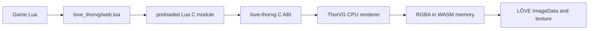

# Experimental web backend

!!! warning "Experimental and not in the desktop release archives"

    Web support requires a custom love.js build. The backend works, is tested in
    WebAssembly, and keeps the public Lua API, but it is not yet a drop-in build
    of LÖVE for browsers. Pin the exact toolchain and test your exported game.

Stock browser ports of LÖVE use PUC Lua 5.1 rather than LuaJIT. That means the
desktop adapter's FFI calls cannot work in a browser. `love-thorvg` solves this
with a small built-in Lua C module instead of trying to emulate FFI in JavaScript.



The architecture has one WebAssembly module and one memory arena. ThorVG is
statically linked into the same custom love.js runtime as LÖVE. The binding
returns RGBA bytes to Lua, and `love.image.newImageData` creates the uploadable
image. No JavaScript bridge is involved during normal Lua rendering.

## What is implemented

- SVG and Lottie decoding and CPU rasterization under Emscripten;
- the same `require('love_thorvg')`, `new`, playback, resize, cache, stats, image,
  and draw API used on desktop;
- assets read through `love.filesystem`, including resolver callbacks for
  relative images and mapped fonts;
- explicit release plus a userdata finalizer as a safety net;
- automated Node proof and a live browser proof on the documentation site.

Threads and SIMD are disabled in the first backend. Raster pixels cross one
additional WASM-to-Lua string copy before becoming `ImageData`; size documents
conservatively and use frame caching for repeatedly visited frames.

## Build the verified WebAssembly core

Install Emscripten, Meson, and Ninja, then run:

```sh
meson setup build-web \
  --cross-file web/emscripten.ini \
  -Dbuild_tests=false \
  -Dweb_harness=true \
  -Dthorvg:threads=false \
  -Dthorvg:simd=false \
  -Dthorvg:file=false
meson compile -C build-web
node tests/web_wasm_test.mjs "$PWD/build-web/love_thorvg_web.js"
```

This produces `love_thorvg_web.js` and `love_thorvg_web.wasm`. The harness is
useful for testing the C ABI and the demo, but it is not a LÖVE runtime.

## Integrate it with love.js

Use a source build of love.js with LuaJIT disabled, as required by that port.
Add these translation units to its final Emscripten target:

```text
native/love_thorvg.cpp
web/love_thorvg_lua.cpp
web/register_module.cpp
```

Also add the ThorVG static dependency, its include paths, and `include/` from
this repository. Build ThorVG with the same options shown above. After love.js
creates its `lua_State`, call:

```cpp
love_thorvg_register_web_module(luaState);
```

That installs `love_thorvg_web` in `package.preload`. Include the complete
`love_thorvg/` directory in the game's virtual filesystem. At runtime,
`love_thorvg/init.lua` detects `love.system.getOS() == 'Web'` and selects the
non-FFI adapter automatically; game code remains unchanged.

Keep all three C++ files and ThorVG in the final link. If dead-code elimination
removes the registration function, explicitly export or call it from the same
translation unit that owns the Lua state.

## Current boundary

This backend does not provide a maintained, prebuilt love.js distribution yet.
Browser audio, input, persistence, packaging, and hosting remain responsibilities
of the chosen LÖVE web runner. The [proof page](web-proof.md) distinguishes what
the automated backend test proves from what still needs end-to-end runtime work.
